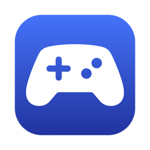

<p align="center"></p>

<h1 align="center">Kumanda</h1>
<p align="center">Use your Mac from the couch with a game controller.</p>
<p align="center"><a href="https://github.com/AlparslanSemiz/Kumanda/actions/workflows/build.yml"></a></p>

Kumanda (Turkish for "remote control") is a small menu bar app for macOS. The left stick moves the pointer, the right stick scrolls, and the buttons click, switch Spaces and press keys. When a game comes to the front, Kumanda steps aside, so the game gets the controller to itself.

It works with any controller macOS supports: Xbox, PlayStation, 8BitDo and other MFi pads.

## Buttons

| Control | Action |
| --- | --- |
| Left stick | Move the pointer. Let go and, after a second, it glides onto the nearest button or link, if one is close |
| Right stick | Scroll |
| Bottom face button | Left click (hold to drag, press twice to double-click) |
| Right face button | Right click |
| Left face button | Esc |
| Top face button | ⌘ Space (Spotlight or Raycast) |
| Menu ☰ | Return |
| View ⧉ | Mission Control |
| LB / RB | Previous / next Space |
| D-pad | Arrow keys (hold to repeat) |
| Hold LT / RT | Slow, precise pointer / fast pointer |
| Press the right stick, or Home | Start or stop [Dikte](https://github.com/yusufipk/dikte) dictation |
| Press both sticks | Turn Kumanda on or off |

Face buttons go by position, not by the letter printed on them, so the bottom one clicks on Xbox, PlayStation, Nintendo and 8BitDo pads alike. Kumanda guesses the layout from the controller's name; set it yourself under **Tuş düzeni** if it guesses wrong.

**Snap to buttons.** Hitting small buttons with a stick is fiddly, so once the stick rests Kumanda looks for the nearest clickable thing (button, link, checkbox, menu item, text field) within about 90 points and glides onto it. On empty space it stays put, and it never moves a pointer you moved with the trackpad. Turn it off or change the wait (0.5 to 2 seconds) in the menu. It reads the screen through the Accessibility permission Kumanda already has.

## Games get the controller

Kumanda pauses on its own while a game is in front. It recognises games by their App Store category. To add an app it misses, open the menu while that app is in front and choose **“… açıkken durdur”** (pause while … is open). Those apps are kept in `~/.config/kumanda/games.txt`, one bundle id per line.

## Install

```sh
curl -fsSL https://raw.githubusercontent.com/AlparslanSemiz/Kumanda/main/install.sh | zsh
```

The script builds Kumanda from source on your Mac, so it needs Apple's Command Line Tools. It installs the app to `~/Applications` and opens it. Then turn on **Kumanda** under System Settings → Privacy & Security → **Accessibility**. To start it at login, use the toggle in its menu.

The menu is in Turkish for now.

## Check what your controller sends

If a button does nothing, check whether macOS sees it at all:

```sh
swift tools/padtest.swift
```

It prints every press for two minutes. Back paddles, for example, usually send nothing until you map them to a button in the controller's own software.

## Keep the permission across rebuilds

If a code-signing certificate named "Veda Local Signing" exists (made by [Veda's](https://github.com/AlparslanSemiz/Veda) `scripts/make_signing_cert.sh`), `build.sh` signs with it. Otherwise the app is signed ad hoc, and macOS asks for Accessibility again after every rebuild.

## Uninstall

```sh
pkill -x Kumanda; rm -rf ~/Applications/Kumanda.app ~/.config/kumanda ~/.local/src/Kumanda
```

## Lint

`swiftlint` needs SourceKit. Without Xcode, point it at the Command Line Tools:

```sh
TOOLCHAIN_DIR=/Library/Developer/CommandLineTools swiftlint
```

## Requirements

macOS 13 or later and the Xcode Command Line Tools (`xcode-select --install`).

## License

MIT
